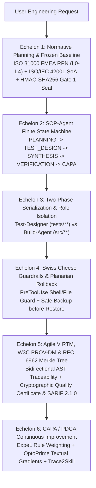

# ISO 9001:2015 / ISO/IEC 42001:2023 / Agile V Quality Pipeline (`iso9000-agentops` v2.0.0)

[](https://github.com/orakulzero/iso9000-agentops/actions)
[](LICENSE)
[](pyproject.toml)
[](pyproject.toml)

A zero-dependency, production-grade **ISO 9001:2015 Quality Management System (QMS)**, **ISO/IEC 42001:2023 AI Management System (AIMS)**, and **Agile V (`arXiv:2602.20684`, Christopher Koch)** Governance Engine for autonomous coding agents (**Google Antigravity**, **Claude Code**, and **MCP-compatible IDEs**).

---

## Normative Standards & Research Foundation

- **Agile V (`arXiv:2602.20684`, Christopher Koch)**: *Structured Verification-Driven AI Loops* — enforces strict bidirectional traceability (`REQ-ID <-> AST Code Symbol <-> Verification Test <-> W3C PROV-DM EvidenceUnit`), Human Gate 1 normative baselines, and role isolation between `Test-Designer` and `Build-Agent` to eliminate self-grading bias.
- **ISO 9001:2015 (Clauses 6.1, 7.5, 8.3, 8.5, 9.1, 10.2)**: Risk-based thinking, documented information control, design & development traceability, production control, independent verification, and CAPA continuous improvement.
- **ISO/IEC 42001:2023 (AI Management System — Annex A)**: Automated Statement of Applicability (SoA) across controls `A.6.2.2`, `A.6.2.4`, `A.7.4`, `A.8.3`, `A.9.3`, and `A.10.2`.
- **ISO 31000 / IEC 60812 FMEA**: Quantitative Failure Mode and Effects Analysis computing `RPN = Severity * Occurrence * Detection` (`1..1000`) with deterministic `L0..L4` escalation and severity override (`S >= 9 -> L4`).
- **W3C PROV-DM & RFC 6962 Certificate Transparency**: Tamper-evident SHA-256 hash chains and binary Merkle audit trees with `0x00` leaf / `0x01` internal node domain separation and $O(\log N)$ inclusion proofs.
- **OASIS SARIF 2.1.0**: Standardized Static Analysis Results Interchange Format export for GitHub Code Scanning and CI/CD quality gates.

---

## Architecture: The 6 Echelons of Agentic Quality (`v2.0.0`)



---

## Key Capabilities in `v2.0.0`

1. **Bidirectional Agile V Requirements Traceability Matrix (`iso9000_agentops.traceability`)**:
   - AST-scans production Python modules (`extract_code_req_links`) and pytest suites (`extract_test_req_links`) to link `REQ-*` identifiers across docstrings, `@pytest.mark.req(...)` decorators, and inline comments.
   - Detects **orphan requirements** (untested), **unimplemented requirements** (no code), **untraced tests**, and **gold-plated public symbols** (unrequested speculative features).
2. **ISO/IEC 42001:2023 AIMS & ISO 31000 FMEA Risk Engine (`iso9000_agentops.aims_42001`)**:
   - Computes quantitative `RPN = S * O * D` (`compute_fmea_rpn`), ranks failure modes (`assess_failure_modes`), and generates an auditable **ISO/IEC 42001:2023 Statement of Applicability** (`generate_iso42001_soa`).
3. **Cryptographic Quality Certificates, SVG Badges & OASIS SARIF 2.1.0 (`iso9000_agentops.certificate`)**:
   - Issues HMAC-SHA256 signed quality certificates (`issue_quality_certificate`, `verify_quality_certificate`), generates standalone SVG badges (`render_compliance_badge_svg`), and exports OASIS SARIF 2.1.0 reports (`export_sarif_report`).
4. **W3C PROV-DM Hash Chains, RFC 6962 Merkle Audit Trees & Senior Diff Tours**:
   - Cryptographic provenance verification (`build_prov_hash_chain`, `build_merkle_audit_tree`, `generate_merkle_inclusion_proof`) and 5-dimension senior code review tours (`build_diff_tour`).
5. **Cryptographic Human Gate 1 Seals & Self-Grading Bias Guard**:
   - Blocks unsealed `L2-L4` execution and prevents `SYNTHESIS` build agents from mutating locked `tests/` via direct file tools or shell redirection.

---

## Quickstart

### Installation

```bash
pip install -e ".[dev]"
```

### End-to-End CLI Lifecycle (`v2.0.0`)

```bash
# 1. Initialize an L2 Frozen Baseline
iso9000-agentops --workspace . init-baseline "(REQ-001) Add HMAC auth; (REQ-002) Add audit log" --risk L2 --offline

# 2. Approve Human Gate 1 (writes 64-char HMAC-SHA256 seal)
iso9000-agentops --workspace . approve-gate1

# 3. Run ISO 31000 FMEA & ISO/IEC 42001:2023 Statement of Applicability
iso9000-agentops --workspace . fmea

# 4. Transition to TEST_DESIGN & SYNTHESIS with Statepoint Checkpoint
iso9000-agentops --workspace . set-phase TEST_DESIGN --role test-designer --emit-brief
iso9000-agentops --workspace . set-phase SYNTHESIS --role implementer --emit-brief
iso9000-agentops --workspace . checkpoint --label pre_synthesis

# 5. Run Independent Verification Oracle & Build W3C PROV-DM Audit Chain
iso9000-agentops --workspace . verify --cmd "pytest -q"

# 6. Build Bidirectional Agile V Requirements Traceability Matrix (RTM)
iso9000-agentops --workspace . rtm

# 7. Issue Signed Quality Certificate, SVG Badge & OASIS SARIF 2.1.0 Report
iso9000-agentops --workspace . certify

# 8. Run CAPA / ExpeL Consolidation & Trace2Skill Extraction
iso9000-agentops --workspace . capa --trace2skill --skill-name verified-auth-sop --offline
```

### MCP Server (`iso9000-agentops-mcp` v2.0.0)

Exposes 9 schema-validated MCP tools (all tool names strictly `<= 64` chars):
- `iso9000_init_baseline`
- `iso9000_approve_gate1`
- `iso9000_set_phase`
- `iso9000_verify_oracle`
- `iso9000_get_audit_chain`
- `iso9000_run_capa`
- `iso9000_traceability_matrix`
- `iso9000_fmea_42001_assess`
- `iso9000_issue_certificate`

---

## License

Released under the [MIT License](LICENSE). Copyright (c) 2026 `orakulzero`.
