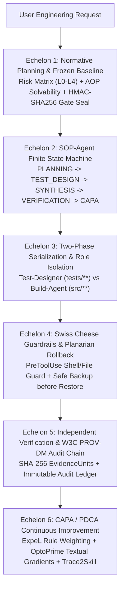

# ISO 9001:2015 / Agile V / AgentOps Quality Pipeline (`iso9000-agentops`)

[](https://github.com/orakulzero/iso9000-agentops/actions)
[](LICENSE)
[](pyproject.toml)

A zero-dependency, production-grade **ISO 9001:2015 / Agile V Quality Management System (QMS)** and **AgentOps Governance Engine** for autonomous coding agents (**Google Antigravity**, **Claude Code**, and **MCP-compatible IDEs**).

---

## Architecture: The 6 Echelons of Agentic Quality



---

## Key Capabilities

1. **Cryptographic Human Gate 1 Seals (`HMAC-SHA256`)**:
   - Tasks classified as `L2-L4` require explicit Human Gate 1 approval (`approve-gate1`) signed with a workspace-local HMAC key (`.supergraph/.gate_secret` or `ISO9000_GATE_SECRET`). Manual text tampering of `human_gate_1_approved: true` in `frozen_baseline.yaml` without a valid `gate_seal_hmac` is automatically rejected.
2. **Self-Grading Bias Prevention (File & Shell Sabotage Guard)**:
   - Enforces strict role separation between `TEST_DESIGN` (`test-designer`, restricted to `tests/**`) and `SYNTHESIS` (`implementer`, restricted to `src/**`, `app/**`).
   - Intercepts both direct file tools (`write_file`, `edit_file`, `Write`, `Edit`) and shell redirection/mutation commands (`run_command`, `Bash`) targeting `tests/` or `.supergraph/frozen_baseline.yaml`.
3. **Safe Planarian Asymmetric Rollback**:
   - Captures clean workspace statepoints (`.supergraph/statepoints/<node_id>/`) prior to synthesis.
   - Upon 3 consecutive oracle failures, automatically backs up in-progress files to `.supergraph/rollback_backups/<timestamp>/` before restoring the clean statepoint.
4. **Multi-Provider LLM Adapter & Own-Target Framing**:
   - Supports `offline` (deterministic regex/clause decomposition), `argon` (Gemini 4 Argon daemon), `openai`, and `anthropic` providers with automatic fallback and domain-neutral prompt framing.
5. **1-Click Hook Installer & Built-in JSON-RPC 2.0 MCP Server**:
   - Generates ready-to-use `PreToolUse`, `PostToolUse`, and `Stop` hooks for **Antigravity Golden Stack** (`supergraph`, `antigravity-monitor`, `agents-learning`) and **Claude Code** (`.claude/settings.json`).
   - Exposes all 6 Echelons over stdio JSON-RPC 2.0 (`iso9000-agentops-mcp`).

---

## Quickstart

### Installation

```bash
pip install -e ".[dev]"
```

### CLI Lifecycle

```bash
# 1. Initialize an L3 Frozen Baseline
iso9000-agentops --workspace . init-baseline "(REQ-001) Add HMAC auth; (REQ-002) Add audit log" --risk L3 --offline

# 2. Approve Human Gate 1 (writes 64-char HMAC-SHA256 seal)
iso9000-agentops --workspace . approve-gate1

# 3. Transition to TEST_DESIGN (Test-Designer role)
iso9000-agentops --workspace . set-phase TEST_DESIGN --role test-designer --emit-brief

# 4. Transition to SYNTHESIS (Build-Agent role) & Save Statepoint
iso9000-agentops --workspace . set-phase SYNTHESIS --role implementer --emit-brief
iso9000-agentops --workspace . checkpoint --label pre_synthesis

# 5. Run Independent Verification Oracle & Build W3C PROV-DM Audit Chain
iso9000-agentops --workspace . verify --cmd "pytest -q"

# 6. Run CAPA / ExpeL Consolidation & Trace2Skill Extraction
iso9000-agentops --workspace . capa --trace2skill --skill-name verified-auth-sop --offline
```

### 1-Click Hook Installation

```bash
# Install Antigravity Golden Stack plugins
iso9000-agentops install-hooks --target antigravity --dest ~/.gemini/config/plugins

# Install Claude Code lifecycle hooks
iso9000-agentops install-hooks --target claude-code --dest ./.claude
```

### MCP Server Configuration

Add `iso9000-agentops-mcp` to your MCP client configuration:

```json
{
  "mcpServers": {
    "iso9000-agentops": {
      "command": "iso9000-agentops-mcp",
      "args": []
    }
  }
}
```

---

## Reproducible 3-Sandbox Benchmark Suite

Run `iso9000-agentops benchmark` or `pytest tests/test_iso9000_agentops.py -v`:

| Sandbox | Target Defect Class | Mechanism Verified | Result |
| :--- | :--- | :--- | :--- |
| `SB1_SelfGradingBias_Sabotage` | Unsealed Gate 1 bypass + direct/shell mutation of `tests/` during `SYNTHESIS` | `verify_gate1_hmac` + `evaluate_pre_tool_guard` | **PASSED (100% Blocked)** |
| `SB2_Planarian_AsymmetricRollback` | Hallucination spiral (3 consecutive test failures) + work loss risk | Backup to `.supergraph/rollback_backups/` + Statepoint restore | **PASSED (100% Restored)** |
| `SB3_CAPA_ExpeL_And_OSS_Audit` | Provenance drift + recurring defects + OSS release leakage | W3C PROV-DM `audit_chain.json` + `Trace2Skill` + 5-Gate OSS Audit | **PASSED (100% Verified)** |

---

## License

Released under the [MIT License](LICENSE). Copyright (c) 2026 `orakulzero`.
